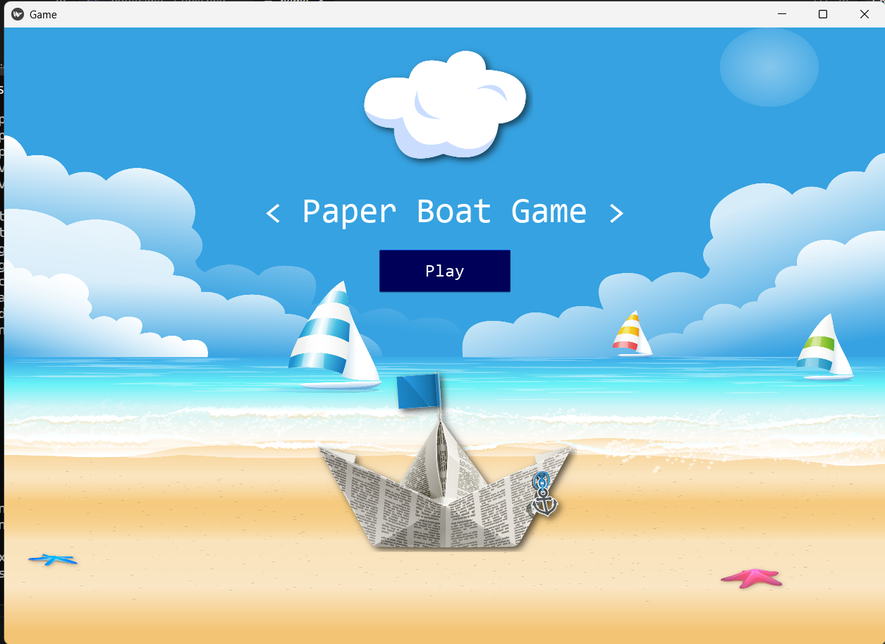
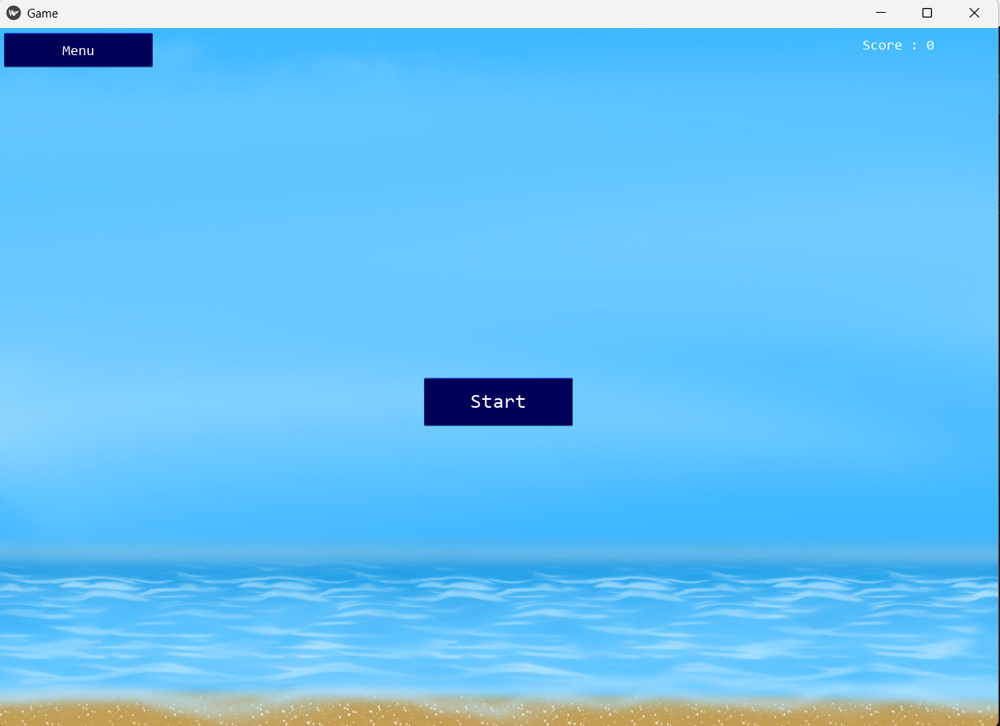
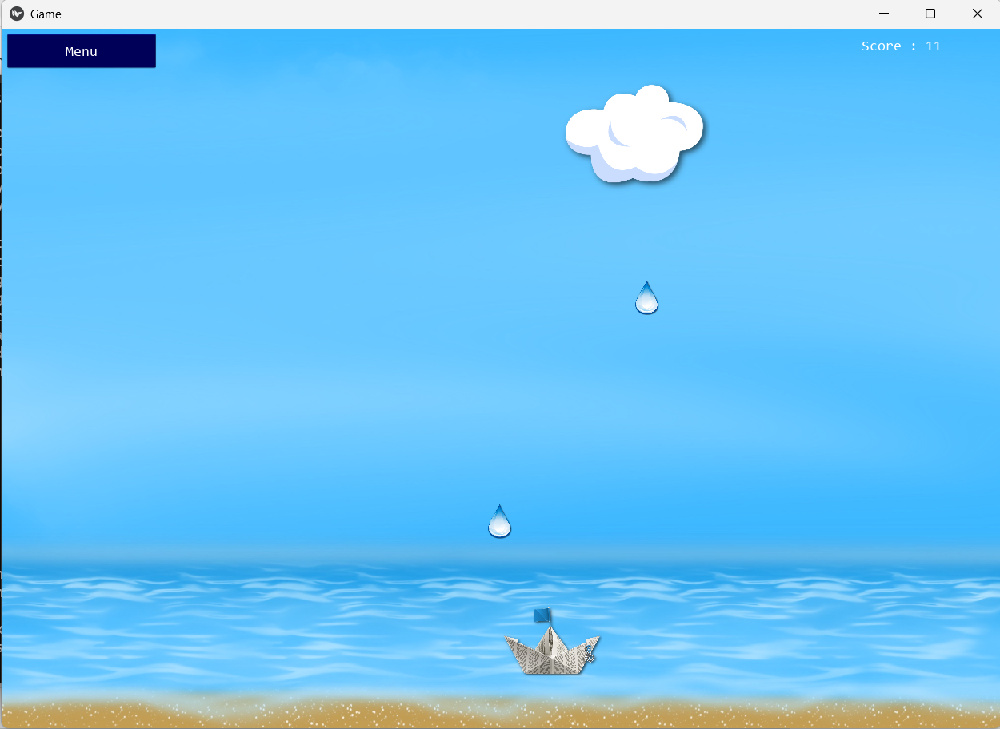
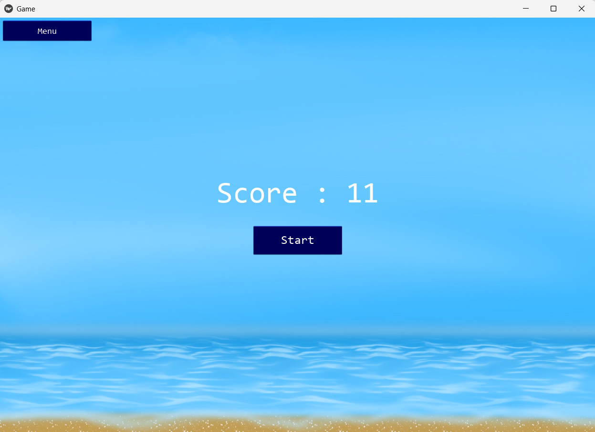

# ⛵ PaperBoat

Jeu d'arcade 2D en temps réel développé en **Programmation Orientée Objet**. Le joueur contrôle un bateau en papier à l'aide du clavier pour esquiver les gouttes de pluie : chaque goutte évitée rapporte **+1 point**, tandis qu'une collision met fin à la partie.

---

## 🎮 Aperçu du jeu

| Écran d'accueil | Lancement | Partie en cours | Fin de partie |
| :---: | :---: | :---: | :---: |
|  |  |  |  |

---

## 🛠️ Architecture & Concepts techniques

* **Boucle de jeu temps réel :** gestion du rafraîchissement graphique, animations fluides et synchronisation des entrées clavier.
* **Architecture Orientée Objet (POO) :** séparation claire des entités (`Joueur`, `Obstacles / Pluie`, `Environnement`) et de leurs interactions.
* **Détection de collisions & scoring :** calcul des zones de collision en temps réel et mise à jour dynamique du score.
* **Gestion des états :** transitions entre l'écran principal (`Play`), l'initialisation (`Start`), la session de jeu et le retour au menu.

---

## 🚀 Lancer le projet en local

### Prérequis
* Python 3.x
* Bibliothèque **Kivy** :
```bash
pip install kivy
 ```


### Exécution
```bash
git clone [https://github.com/NTMA-vn/PaperBoat.git](https://github.com/NTMA-vn/PaperBoat.git)
cd PaperBoat
# Remplacer par ta commande de lancement (ex: python main.py ou javac/java Main)
